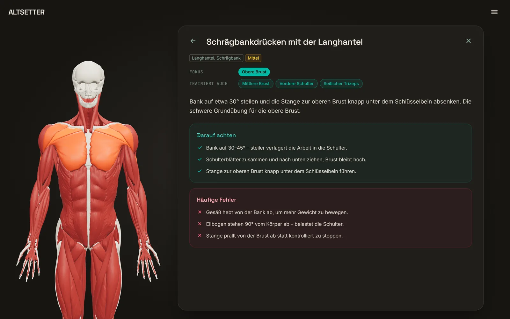
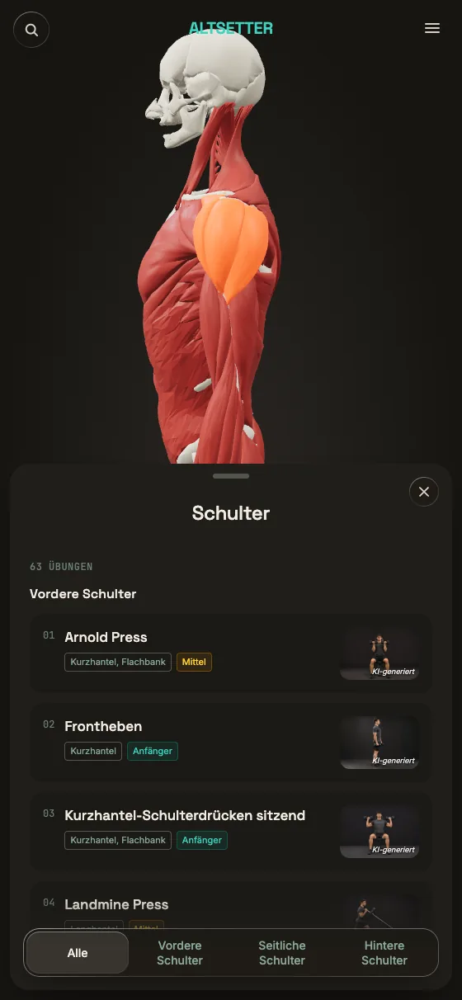
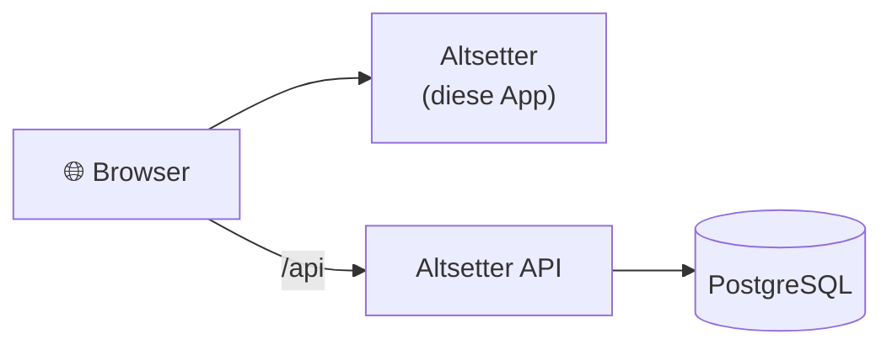
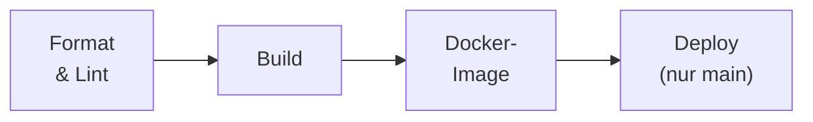

<div align="center">

# Altsetter

**Muskel antippen, passende Übung finden.**

Ein Übungsfinder fürs Gym mit einem anatomischen 3D-Körper.

[](https://github.com/adrian-rostin/altsetter/actions/workflows/ci-cd.yml)


**[→ altsetter.adrianrostin.de](https://altsetter.adrianrostin.de)**

<br>


&nbsp;


</div>

<br>

## Worum geht's?

Das Gerät ist besetzt, und du willst trotzdem denselben Muskel trainieren? Genau dafür ist
Altsetter da:

1. **Muskel antippen** – direkt am 3D-Körper
2. **Übung aussuchen** – alle Übungen, die diesen Muskel trainieren
3. **Richtig ausführen** – mit Tipps, worauf man achten sollte, und den häufigsten Fehlern

## Was die App kann

|     |                                                                                                 |
| --- | ----------------------------------------------------------------------------------------------- |
| 🧍  | **3D-Körper** mit 86 Muskeln, frei drehbar und zoombar                                          |
| 🎯  | **Muskelgruppen**: Der erste Klick wählt z. B. die ganze Brust, ein zweiter nur die obere Brust |
| 🎥  | **Kamerafahrt**: Die Kamera dreht sich automatisch dahin, wo der Muskel am besten zu sehen ist  |
| 🏋️  | **142 Übungen** mit Schwierigkeit, Equipment, „Darauf achten“ und „Häufige Fehler“              |
| 💡  | **Hervorhebung**: Hauptmuskeln leuchten hell, Muskeln, die mitarbeiten, etwas schwächer         |
| 🌍  | **Deutsch und Englisch**: Umschalten im Menü, die Wahl merkt sich der Browser                   |
| 📱  | **Fürs Handy gemacht**: Die Übungsliste ist ein Panel, das man hochziehen und wegwischen kann   |

## So hängt alles zusammen



Diese App ist das, was man im Browser sieht. Muskeln und Übungen kommen aus der
[Altsetter API](https://github.com/adrian-rostin/altsetter-api), die sie aus einer eigenen
Datenbank liest. Beide laufen unter derselben Adresse: alles unter `/api` geht an die API.

## Selbst starten

**Du brauchst:** Node.js 22.12 oder neuer und die
[Altsetter API](https://github.com/adrian-rostin/altsetter-api), lokal gestartet auf Port 8080.

```bash
npm install
npm start
```

Danach läuft die App auf **http://localhost:4200**. Anfragen an `/api` leitet der Dev-Server
automatisch an die lokale API weiter.

<details>
<summary><b>Alle Befehle</b></summary>

<br>

| Befehl                 | Was passiert                                     |
| ---------------------- | ------------------------------------------------ |
| `npm start`            | Startet die App lokal mit automatischem Neuladen |
| `npm run build`        | Baut die fertige Version nach `dist/altsetter/`  |
| `npm run lint`         | Prüft den Code auf Fehler (`lint:fix` repariert) |
| `npm run format`       | Formatiert den Code einheitlich                  |
| `npm run format:check` | Prüft nur die Formatierung, wie in der Pipeline  |
| `npm run model:prune`  | Verkleinert das 3D-Modell auf die Gym-Muskeln    |
| `npm run icons`        | Erzeugt Favicon und App-Icons aus `favicon.svg`  |

</details>

## Adressen

Jede Ansicht hat ihre eigene Adresse. So kann man Links teilen, und Neuladen oder der
Zurück-Button führen wieder genau dorthin. Die Adressen sind in jeder Sprache gleich.

| Adresse                                           | Zeigt                                  |
| ------------------------------------------------- | -------------------------------------- |
| `/muscle/chest`                                   | eine Muskelgruppe, hier die Brust      |
| `/muscle/upper-chest`                             | einen einzelnen Muskel                 |
| `/muscle/upper-chest/incline-barbell-bench-press` | eine Übung, geöffnet bei diesem Muskel |

## Sprachen

Die App gibt es auf **Deutsch** und **Englisch**. Beim ersten Besuch entscheidet die Sprache des
Browsers, danach die eigene Wahl im Menü (unten: **DE | EN**).

- Die Texte der App selbst (Buttons, Überschriften …) stehen in
  [`src/app/i18n/messages.ts`](src/app/i18n/messages.ts). Fehlt im Englischen ein Text, bricht der
  Build ab, so kann keiner vergessen werden.
- Muskeln und Übungen liefert die API gleich in der richtigen Sprache.

## Projektaufbau

```text
src/app/
├── components/
│   ├── muscle-viewer/     der 3D-Körper: Modell, Klicks, Hervorhebung, Kamera
│   └── exercise-panel/    die Karte mit Übungsliste und Übungsdetails
├── i18n/                  Sprachen und alle Texte der App
├── layout/                wo die Karte sitzt und wohin der Körper ausweicht
├── models/                Datentypen, so wie die API sie liefert
├── services/              API-Zugriff, Auswahl und Adresszeile
└── shared/                kleine Helfer

public/models/             das 3D-Modell
tools/                     Skripte für 3D-Modell und Icons
nginx/                     Webserver-Einstellungen
k8s/                       Kubernetes-Dateien
```

<details>
<summary><b>Technik im Detail</b></summary>

<br>

| Bereich      | Technik                                                                         |
| ------------ | ------------------------------------------------------------------------------- |
| Frontend     | Angular 21 mit Signals (ohne zone.js), TypeScript                               |
| Styling      | Tailwind CSS 4, Schriften selbst ausgeliefert                                   |
| 3D           | Three.js, komprimiertes glTF-Modell (Draco), three-mesh-bvh für schnelle Klicks |
| Animation    | View Transitions API, Kamerafahrten auf einer Kugelbahn um den Körper           |
| Qualität     | ESLint (streng, inkl. Barrierefreiheit), Prettier                               |
| Auslieferung | nginx ohne Root-Rechte im Docker-Image                                          |
| Betrieb      | Kubernetes (k3s), Traefik, cert-manager, GitHub Actions                         |

**Wie ein Klick zum Muskel wird:** Jedes Teil des 3D-Modells hat einen Namen, z. B.
`Long_head_of_biceps_brachii_left`. Die App macht daraus `long head of biceps brachii` (klein,
ohne Unterstriche, ohne Seite). So gehören linke und rechte Seite immer zum selben Muskel, und die
API sagt, welcher Muskel das ist.

</details>

## Das 3D-Modell

Das Modell (`public/models/male-anatomy.glb`, ca. 1 MB) stammt aus
[Z-Anatomy](https://github.com/Z-Anatomy/The-blend). Es wurde in zwei Schritten auf das
reduziert, was im Gym zählt:

1. [`tools/export-anatomy.py`](tools/export-anatomy.py) exportiert in Blender alle sichtbaren
   Muskeln und Knochen.
2. `npm run model:prune` entfernt alles, was man nicht gezielt trainiert, z. B. Gesichts- und
   Handmuskeln.

Nur Muskeln sind anklickbar; Knochen und Sehnen sind zur Orientierung da.

## Veröffentlichen

Bei jedem Push prüft GitHub Actions den Code
([`.github/workflows/ci-cd.yml`](.github/workflows/ci-cd.yml)):



Auf `main` wird das Image anschließend automatisch in den Kubernetes-Cluster ausgerollt. Im
Cluster laufen zwei Kopien der App, mit schreibgeschütztem Dateisystem und ohne Root-Rechte. Das
HTTPS-Zertifikat kommt von Let's Encrypt.

Für das Deployment braucht das Repository das Secret `KUBECONFIG`.

## Datenschutz

- **Keine Cookies, kein Tracking**, keine Inhalte von fremden Servern
- Modell, Schriften und Übungen kommen alle vom eigenen Server, ohne Zugriffsprotokolle
- Im Browser wird nur die gewählte Sprache gespeichert, sonst nichts
- Die Domain läuft über Cloudflare; das steht in der
  [Datenschutzerklärung](https://adrianrostin.de/datenschutz)

## Lizenzen

- **3D-Modell:** abgeleitet von Z-Anatomy, [CC BY-SA 4.0](https://creativecommons.org/licenses/by-sa/4.0/).
  Das bearbeitete Modell steht unter derselben Lizenz, siehe
  [`public/models/ATTRIBUTION.md`](public/models/ATTRIBUTION.md).
- **Schriften:** Inter, Space Grotesk und JetBrains Mono, jeweils SIL Open Font License 1.1.
- **Quellcode, Texte und Übungsbeschreibungen:** urheberrechtlich geschützt, nur zur Ansicht.

> [!NOTE]
> Die Übungen und Tipps dienen der allgemeinen Information und ersetzen keine Beratung durch
> Ärzte, Physiotherapeuten oder Trainer.
